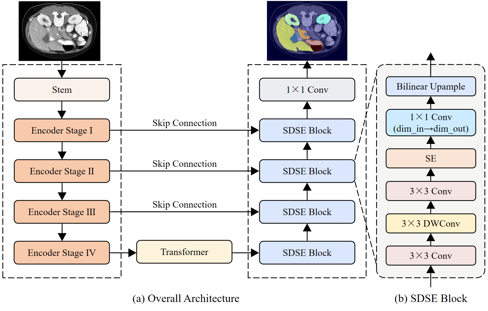
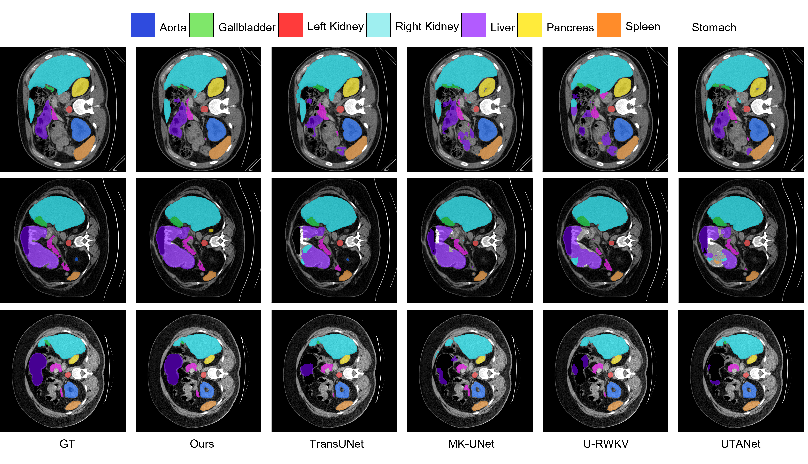

# SDSE-Net

SDSE-Net 是一个面向医学图像语义分割的 2D 深度学习网络。模型保留了
RWKV-UNet 编码器的主体结构和多尺度跳跃连接，在编码器最深层加入 Transformer
bottleneck，并使用改进的解码器恢复空间分辨率。

本仓库包含模型定义、Synapse/ACDC 数据集读取代码、训练脚本、测试脚本和批量测试
工具。模型入口位于 [`SDSE_Net.py`](./SDSE_Net.py)，顶层网络类为
`SDSE_Net`。

## 目录

- [项目结构](#项目结构)
- [模型简介](#模型简介)
- [模型结构与分割结果](#模型结构与分割结果)
- [环境配置](#环境配置)
- [数据集与模型权重下载](#数据集与模型权重下载)
- [数据准备](#数据准备)
- [预训练权重](#预训练权重)
- [训练](#训练)
- [测试与推理](#测试与推理)
- [自动批量测试](#自动批量测试)
- [输出文件](#输出文件)
- [注意事项](#注意事项)
- [致谢与引用](#致谢与引用)

## 项目结构

```text
SDSE-Net/
├── SDSE_Net.py              # SDSE_Net、编码器和解码器定义
├── train.py                 # 训练入口
├── test.py                  # 测试和推理入口
├── trainer.py               # Synapse、ACDC、BUSI 训练流程
├── run_workflow.py          # 训练后自动批量测试
├── auto_test_Synapse.py     # 批量测试 checkpoint
├── utils.py                 # 损失函数、推理和评价工具
├── module/
│   └── basic_modules.py     # 基础网络模块
├── ccm/
│   ├── ccm.py               # CCM 特征融合模块
│   └── main_blocks.py       # CCM 依赖模块
├── datasets/
│   ├── dataset_synapse.py   # Synapse 数据读取
│   └── dataset_acdc.py      # ACDC 数据读取
├── cuda/
│   ├── wkv_op.cpp           # WKV C++ 扩展
│   └── wkv_cuda.cu          # WKV CUDA 实现
├── figs/
│   ├── Figure_1.png         # 模型结构图
│   └── Figure_2.png         # 分割结果可视化图
├── lists/                   # 数据集列表文件
├── ckpts/                   # 示例 checkpoint
└── requirements.txt         # Python 依赖
```

## 模型简介

SDSE-Net 的主要设计如下：

1. **RWKV 编码器**  
   使用 `RWKV_UNet_encoder_B` 作为编码器，通过多阶段特征提取逐步降低空间
   分辨率并增加通道数。
2. **Transformer bottleneck**  
   在编码器最深层的 `stage4` 后进行通道升维，经过多个 Transformer bottleneck
   模块建模全局上下文，再将通道数映射回解码器所需的维度。
3. **多尺度跳跃连接**  
   编码器的中间层特征通过 `CCMix`/`CCM` 模块进行融合和增强，再与解码器
   对应尺度的特征拼接。
4. **改进解码器**  
   解码阶段由 4 个 `UpBlock` 组成。每个模块包含卷积特征处理、投影层和
   双线性上采样，用于逐步恢复特征图分辨率。
5. **分割头**  
   最后使用 `1x1` 卷积将 24 个通道映射为类别数，输出形状为
   `(batch_size, num_classes, height, width)`。

当前 `SDSE_Net` 的默认配置为：

| 配置项 | 默认值 |
|---|---:|
| 输入通道数 | 1 |
| 输入图像尺寸 | 224 × 224 |
| 输出类别数 | Synapse 为 9 |
| 编码器 | `RWKV_UNet_encoder_B` |
| 预训练编码器权重 | `net_B.pth` |

对于单通道输入，模型在前向传播开始时将图像复制为 3 个通道，以适配编码器
的输入结构。

## 模型结构与分割结果

模型结构图和分割结果可视化图片位于 `figs` 文件夹中。

### 模型结构



### 分割结果可视化



## 环境配置

建议使用 Python 3.9，并使用支持 CUDA 的 PyTorch 环境。项目包含 CUDA 扩展
源码 `cuda/wkv_op.cpp` 和 `cuda/wkv_cuda.cu`，因此运行模型时需要可用的 CUDA
编译环境。

```bash
conda create -n sdse-net python=3.9
conda activate sdse-net

# 请根据本机 CUDA 版本安装匹配的 PyTorch 和 torchvision
pip install torch torchvision
pip install -r requirements.txt
```

`requirements.txt` 中包含项目使用的主要依赖，包括：

- PyTorch 相关组件
- `timm`
- `einops`
- `numpy`、`scipy`、`scikit-image`
- `h5py`
- `albumentations`
- `SimpleITK`、`MedPy`
- `tensorboard`

## 数据集与模型权重下载

由于 GitHub 单个文件大小限制，以下五个文件未上传到本仓库，而是统一存放在
[Hugging Face 模型仓库](https://huggingface.co/aili-yasi/SDSE-Net/tree/main)中。
请进入该页面下载对应文件，并按照下表放置到项目目录：

| Hugging Face 文件 | 下载后放置位置 | 用途 |
|---|---|---|
| `net_B.pth` | 项目根目录 `net_B.pth` | 编码器预训练权重 |
| `Synapse.zip` | 项目根目录 `data/Synapse.zip`，然后解压为 `data/Synapse/` | Synapse 数据集 |
| `transunet_ACDC.zip` | 项目根目录 `data/transunet_ACDC.zip`，然后解压为 `data/ACDC/` | ACDC 数据集 |
| `ckpts/Synapse_base.pth` | `ckpts/Synapse_base.pth` | Synapse 完整模型 checkpoint |
| `ckpts/acdc_base.pth` | `ckpts/acdc_base.pth` | ACDC 完整模型 checkpoint |

下载并解压后，项目目录应至少包含以下结构：

```text
SDSE-Net/
├── net_B.pth
├── data/
│   ├── Synapse/
│   │   ├── train_npz/
│   │   └── test_vol_h5/
│   └── ACDC/
│       ├── ACDC_training_slices/
│       └── ACDC_training_volumes/
└── ckpts/
    ├── Synapse_base.pth
    └── acdc_base.pth
```

如果压缩包解压后产生了额外的同名父目录，请调整目录层级，确保训练和测试脚本能够
直接访问 `data/Synapse/` 或 `data/ACDC/`。运行脚本时请始终使用项目根目录作为当前
工作目录。

## 数据准备

### Synapse

训练脚本默认读取：

```text
data/Synapse/train_npz/
lists/lists_Synapse/train.txt
lists/lists_Synapse/test_vol.txt
```

推荐的数据组织形式为：

```text
data/
└── Synapse/
    ├── train_npz/
    │   ├── case0005_slice000.npz
    │   └── ...
    └── test_vol_h5/
        ├── case0001.npy.h5
        └── ...
```

Synapse 的训练和测试读取方式不同：

- 训练时，`lists/lists_Synapse/train.txt` 中每行是一个样本名，不带扩展名；
  数据加载器从 `train_npz/<样本名>.npz` 读取 `image` 和 `label` 数组。
- 测试时，`lists/lists_Synapse/test_vol.txt` 中每行是一个病例名，不带扩展名；
  数据加载器从 `test_vol_h5/<病例名>.npy.h5` 读取 `image` 和 `label` 数组。
- 训练图像会经过 `RandomGenerator` 处理：按需进行亮度/对比度变化和随机裁剪，
  然后使用最近邻插值调整到 `img_size × img_size`，并转换为单通道张量。
- 测试体数据不使用训练增强；测试脚本通过 `test_single_volume` 对每个病例的
  2D 切片进行推理，并计算各类别 Dice 和 HD95。

### ACDC

ACDC 数据根目录默认为 `data/ACDC`，目录结构应为：

```text
data/
└── ACDC/
    ├── ACDC_training_slices/
    │   ├── patient001_frame01_slice_0.h5
    │   └── ...
    └── ACDC_training_volumes/
        ├── patient001_frame01.h5
        └── ...
```

ACDC 数据划分和文件读取逻辑位于
[`datasets/dataset_acdc.py`](./datasets/dataset_acdc.py) 中：

- `patient001` 至 `patient020`：测试集
- `patient021` 至 `patient030`：验证集
- 其余病例：训练集

具体读取方式如下：

- 训练阶段从 `ACDC_training_slices/` 读取切片级 `.h5` 文件中的 `image` 和
  `label` 数据，并使用 `RandomGenerator` 进行随机翻转、随机旋转、亮度/对比度
  变化和随机裁剪，再调整到 `img_size × img_size`。
- 验证和测试阶段从 `ACDC_training_volumes/` 读取体数据 `.h5` 文件，不使用
  `RandomGenerator`。
- 每个 ACDC `.h5` 文件应包含 `image` 和 `label` 两个数据集。测试时，病例名由
  文件名去掉 `.h5` 后得到。

### BUSI

训练和测试脚本保留了 BUSI 数据集的配置入口，但当前仓库中未包含
`datasets/dataset_busi.py`。如果需要运行 BUSI，需要补充对应的数据集实现以及
数据目录。

## 预训练权重

`SDSE_Net` 默认尝试加载编码器预训练权重：

```text
net_B.pth
```

训练时可以通过 `--pretrained_path` 指定权重文件：

```bash
python train.py --pretrained_path path/to/net_B.pth
```

如果不使用编码器预训练权重，可以传入空值或在模型构造时设置
`pretrained_path=None`。测试阶段默认不重新加载编码器预训练权重，而是加载完整
分割模型的 checkpoint。

## 训练

请在项目根目录执行训练命令。

### Synapse 训练示例

```bash
python train.py ^
  --dataset Synapse ^
  --max_epochs 30 ^
  --batch_size 24 ^
  --base_lr 0.001 ^
  --img_size 224 ^
  --pretrained_path net_B.pth
```

PowerShell 或 Linux/macOS 中也可以写成一行：

```bash
python train.py --dataset Synapse --max_epochs 30 --batch_size 24 --base_lr 0.001 --img_size 224 --pretrained_path net_B.pth
```

### ACDC 训练示例

```bash
python train.py --dataset ACDC --max_epochs 30 --batch_size 24 --base_lr 0.001 --img_size 224 --pretrained_path net_B.pth
```

### 常用训练参数

| 参数 | 默认值 | 说明 |
|---|---:|---|
| `--dataset` | `Synapse` | `Synapse`、`ACDC` 或 `busi` |
| `--max_epochs` | `30` | 最大训练轮数 |
| `--max_iterations` | `30000` | 最大迭代数，用于输出目录命名 |
| `--batch_size` | `24` | 每个 GPU 的 batch size |
| `--base_lr` | `0.001` | 初始学习率 |
| `--img_size` | `224` | 输入图像边长 |
| `--gpu` | `0` | 使用的 GPU 编号 |
| `--n_gpu` | `1` | GPU 数量参数 |
| `--seed` | `1234` | 随机种子 |
| `--pretrained_path` | `net_B.pth` | 编码器预训练权重路径 |

训练过程使用 AdamW 优化器，并记录交叉熵损失、Dice 损失和总损失。不同数据集
的训练函数位于 [`trainer.py`](./trainer.py)。

## 测试与推理

### 使用默认 checkpoint 测试

```bash
python test.py --dataset Synapse --img_size 224
```

测试脚本会在训练输出目录中查找 `best_model.pth`；如果不存在，则尝试查找对应
的 epoch checkpoint。

### 指定 checkpoint 测试

```bash
python test.py ^
  --dataset Synapse ^
  --img_size 224 ^
  --path_specific ckpts/Synapse_base.pth
```

Linux/macOS 或 PowerShell 中的一行写法：

```bash
python test.py --dataset Synapse --img_size 224 --path_specific ckpts/Synapse_base.pth
```

### 保存预测结果

添加 `--is_savenii` 后，测试结果会保存到 `predictions` 目录：

```bash
python test.py --dataset Synapse --img_size 224 --path_specific ckpts/Synapse_base.pth --is_savenii
```

测试阶段会计算每个类别的 Dice 和 HD95，并在日志中输出平均结果。

## 自动批量测试

`auto_test_Synapse.py` 可以自动寻找指定目录中的 `.pth` 文件，并按照文件名中的
数字排序后逐个运行测试：

```bash
python auto_test_Synapse.py --weights_dir outputs/rwkvSynapse224/exp1_pretrain_...
```

也可以使用 [`run_workflow.py`](./run_workflow.py) 自动执行训练和批量测试：

```bash
python run_workflow.py --dataset Synapse --max_epochs 30 --img_size 224
```

该脚本会：

1. 调用 `train.py` 训练模型；
2. 根据训练参数计算输出目录；
3. 调用 `auto_test_Synapse.py` 测试目录中的 checkpoint。

## 输出文件

训练输出目录由数据集、图像尺寸、训练轮数、batch size、学习率和随机种子共同
决定，默认形式类似：

```text
outputs/
└── rwkvSynapse224/
    └── exp1_pretrain_bs24_lr0.001_224/
        ├── best_model.pth
        ├── epoch_*.pth
        └── ...
```

训练日志和 TensorBoard 标量写入对应的实验目录。可以使用 TensorBoard 查看训练
曲线：

```bash
tensorboard --logdir outputs
```

测试日志默认写入 `test_log`，启用 `--is_savenii` 时预测结果写入
`predictions/<experiment>/<checkpoint>/`。

## 注意事项

1. 请始终在项目根目录运行脚本，否则相对路径
   `data/`、`lists/`、`cuda/` 和权重路径可能无法正确解析。
2. 当前训练和测试入口使用 CUDA；运行前请确认 `torch.cuda.is_available()` 为
   `True`，并安装与本机驱动匹配的 PyTorch。
3. `SDSE_Net.py` 导入时会编译/加载 WKV CUDA 扩展，首次运行可能需要较长时间。
4. `--img_size` 应与训练 checkpoint 使用的尺寸保持一致。
5. `--num_classes` 会根据数据集配置自动设置，通常不需要手动修改。
6. Windows 命令行使用 `^` 换行，Linux/macOS 使用反斜杠 `\` 换行；也可以直接
   使用单行命令。

## 致谢与引用

本项目使用或参考了以下项目中的部分实现：

- [TransUNet](https://github.com/Beckschen/TransUNet)
- [RWKV-UNet](https://github.com/GongRuiFeng/RWKV-UNet)
- [Vision-RWKV](https://github.com/OpenGVLab/Vision-RWKV)
